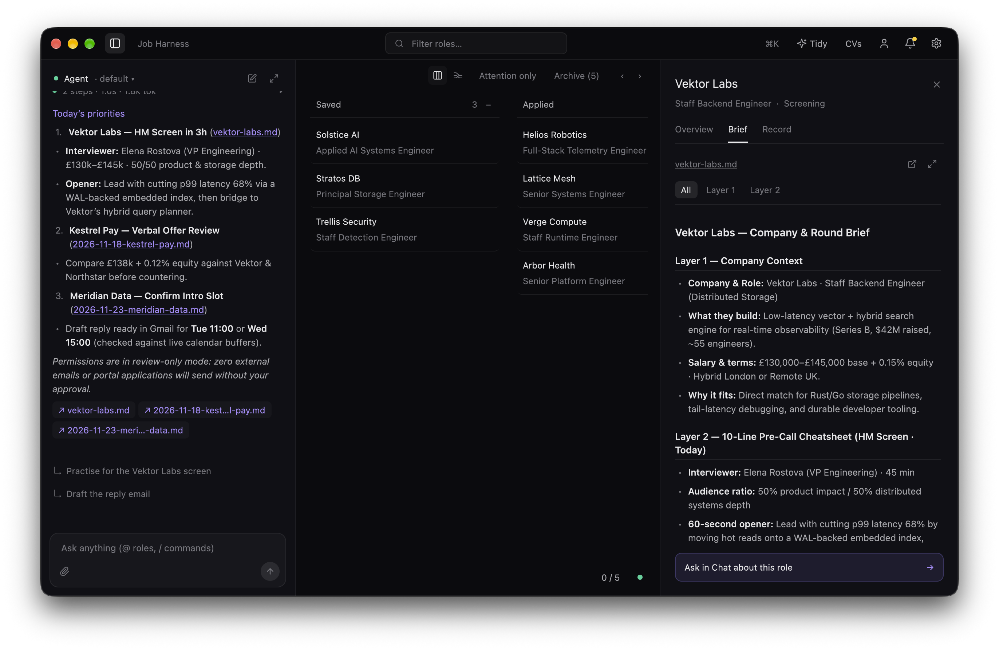
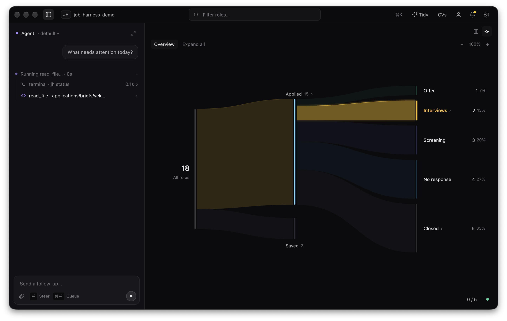
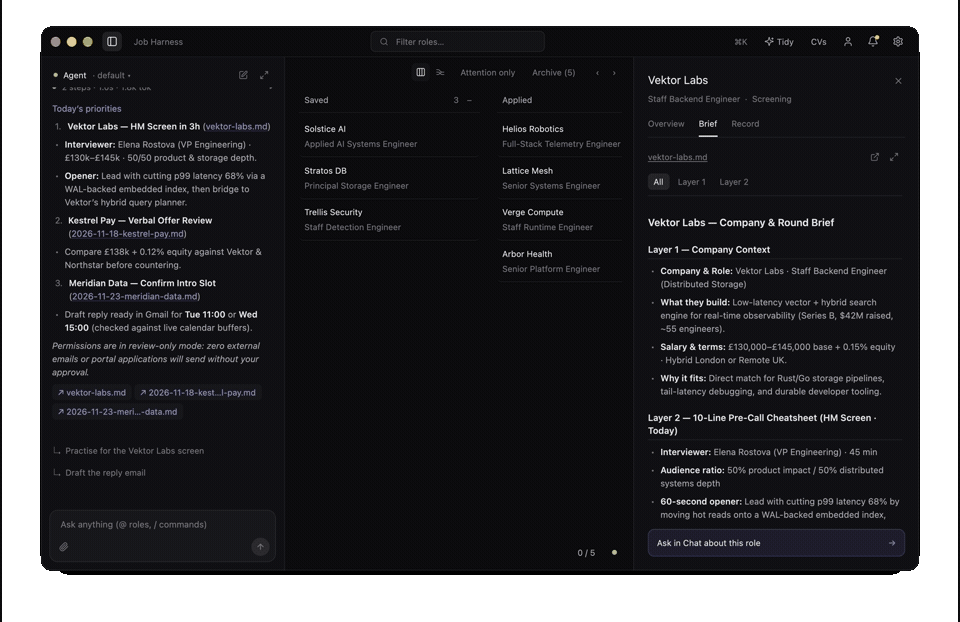
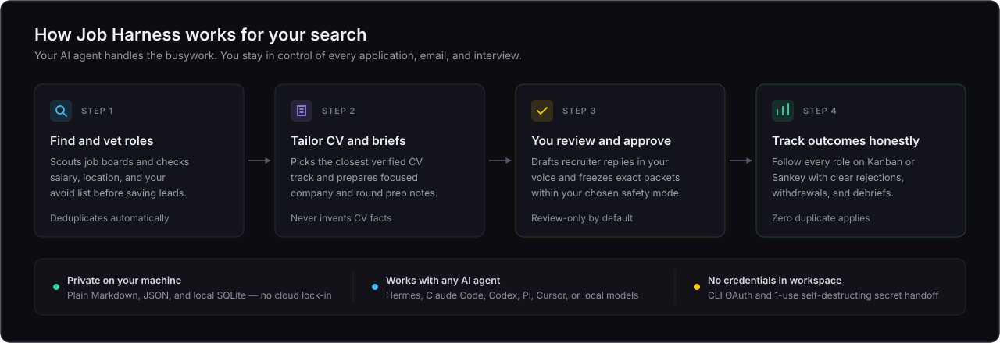
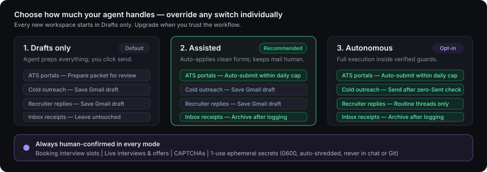

<div align="center">
  
  <h1>Job Harness</h1>
  <p><strong>Local-first AI job search workbench, job application tracker, and MCP server in Rust.</strong><br>
  Track every application, tailor verified CVs, prep 2-layer interview briefs, and block duplicate applies with Claude Code, Codex, Hermes, Cursor, or any AI agent.</p>
  <p>
    <a href="https://github.com/machineyearningengineer/job-harness/releases"></a>
    
    
    
    
    <a href="LICENSE"></a>
  </p>
  <p>
    <a href="#quick-start">Quick Start</a> ·
    <a href="#why-job-harness">Why</a> ·
    <a href="#job-harness-vs-the-alternatives">Compare</a> ·
    <a href="#how-it-works">How It Works</a> ·
    <a href="#delegation--safety">Safety</a> ·
    <a href="#frequently-asked-questions">FAQ</a> ·
    <a href="#documentation">Docs</a>
  </p>
</div>

<br>

<p align="center">
  
</p>
<p align="center">
  <sub><em>Synthetic demo workspace:</em> Chief-of-staff triage with clickable citations, deterministic local Kanban board, and 2-layer interview cheatsheet.</sub>
</p>

---

## Why Job Harness

AI agents are great at researching companies, tailoring CVs, and drafting recruiter replies — until they lose track of what they applied to, double-email a recruiter, or invent resume metrics.

**Job Harness fixes the missing half:** a fast, local Rust ledger and native workbench that gives **any** AI agent durable memory and hard safety rails while keeping every file on your machine.

- **One truthful source of record:** Your master CV, role tracks, approved answers, interview debriefs, and submitted packets live in one private folder — never locked inside a cloud SaaS or one agent's chat history.
- **Zero accidental double-applies:** Every submission freezes an immutable SHA-256 packet, checks your daily cap, and blocks duplicate retries when a portal outcome is still unconfirmed.
- **2-layer interview prep:** Maintains one canonical company brief per employer plus focused 10-line pre-call cheatsheets 90 minutes before interviews.
- **Honest funnel visibility:** Swap cleanly between Kanban and an interactive native **Sankey flow** that keeps **Rejected**, **Withdrawn**, and **Other closed** outcomes distinct — never guessed from silence.

<p align="center">
  
</p>

<details>
<summary><strong>Watch full animated walkthrough (demo.gif)</strong></summary>
<br>
<p align="center">
  
</p>
</details>

---

## Job Harness vs. the alternatives

Most open-source job bots optimize for blasting applications. Serious job searches break *after* you click submit — duplicate outreach, fabricated CV claims, forgotten recruiter threads, and zero interview prep.

| Capability | Job Harness | Career-Ops | Auto-apply bots *(ApplyPilot, AIHawk)* | Spreadsheets / Notion |
|---|---|---|---|---|
| **Core architecture** | **Typed Rust MCP server + SQLite ledger + native GPUI desktop app** | Prompt/skill pipeline + Go TUI | Python scraping & form-fill bot | Manual row tracking |
| **Agent & model lock-in** | **Any MCP/CLI agent** *(Claude Code, Codex, Hermes, Cursor, Pi, local)* | Claude Code / Codex / OpenCode CLI | Tied to one bot loop & provider | None |
| **CV integrity** | **Verified master + child tracks**, SHA-256 frozen per submit — zero invented facts | Per-job tailored PDF from master CV | Per-job LLM rewrites (drift risk) | Manual copy-paste |
| **Double-apply & email safety** | **Hard transactional lock** — blocks unconfirmed retries & checks live Sent mail | Human-in-the-loop (manual submit) | Best-effort local logs | Human memory |
| **Interview prep & inbox** | **2-layer company + round briefs**, native macOS alerts, inbox triage & debriefs | Scoring rubric, STAR stories & negotiation | Not covered | Unstructured docs |
| **Funnel visibility** | Native Kanban + **Sankey flow** *(Rejected vs Withdrawn vs Ghosted)* | Terminal pipeline TUI | Raw apply counter | Manual formulas |
| **Privacy & secrets** | **100% local Markdown + SQLite**, 1-use self-destructing secret handoff | 100% local files | Plaintext YAML / env configs | Cloud-hosted |
| **License** | **MIT** | MIT | AGPL-3.0 / MIT | Proprietary |

---

## How It Works

<p align="center">
  
</p>

Your agent (Hermes, Claude Code, Codex, Pi, Cursor, or a local model) handles reasoning and external connectors. Job Harness enforces exact state, deduplication, and fail-closed permissions — so you can switch models or runtimes anytime with zero migration. *(See [docs/ARCHITECTURE.md](docs/ARCHITECTURE.md) for the full technical system whiteboard.)*

---

## Delegation & Safety

Pick one of three delegation modes in **Settings** (or override any individual rule in `config/career-ledger.json`):

<p align="center">
  
</p>

Every external submission freezes an immutable packet, enforces your daily cap, and checks live Sent mail before sending or replying. Portal logins and tokens pass through an out-of-band **1-use secret modal** (`jh secret`, see [docs/SECRETS.md](docs/SECRETS.md)) that auto-shreds after read and never enters chat history or Git.

---

## Quick Start

### 1. Paste into your AI agent *(fastest)*

Using **Claude Code, Codex, Hermes, Cursor, or OpenCode**? Paste this single prompt:

```text
Read https://raw.githubusercontent.com/machineyearningengineer/job-harness/main/docs/AGENT-SETUP.md and set up Job Harness for me at ~/Career/workspace.
```

### 2. Or install in one line

```sh
# macOS / Linux
curl -fsSL https://raw.githubusercontent.com/machineyearningengineer/job-harness/main/scripts/get.sh | sh

# or with Homebrew (macOS / Linux); desktop app: brew install --cask machineyearningengineer/tap/job-harness
brew install machineyearningengineer/tap/job-harness

# Initialize a private workspace & print MCP config
jh setup --workspace "$HOME/Career/workspace"
jh --root "$HOME/Career/workspace" connect mcp
```

*(Windows PowerShell: `irm https://raw.githubusercontent.com/machineyearningengineer/job-harness/main/scripts/get.ps1 | iex`)*

### 3. Open the Desktop App *(no terminal required)*

Download **Job Harness.app** from [GitHub Releases](https://github.com/machineyearningengineer/job-harness/releases) *(Apple Silicon macOS verified; Intel macOS, Linux & Windows previews)*, drag to **Applications**, and click **Try with sample data** to explore a live workspace immediately.

The app is unsigned: the first time, right-click it and choose **Open**, or run `xattr -d com.apple.quarantine "/Applications/Job Harness.app"`.

Or run from a local checkout in one command:

```sh
make desktop-demo
```

---

## Frequently Asked Questions

**How is Job Harness different from Career-Ops, ApplyPilot, or AIHawk?**  
Auto-apply bots like ApplyPilot and AIHawk focus on scraping job boards and mass-submitting forms through one Python script. Career-Ops is a great Claude Code skill workflow and Go TUI focused on rubric scoring and tailored PDFs. **Job Harness** goes further as a **typed Rust MCP server, transactional SQLite ledger, and native GPUI desktop workbench** that works with *any* agent — adding hard double-apply locks, live Sent-mail verification, inbox triage, 2-layer company + round interview briefs, native macOS alerts, interactive Sankey analytics, and a 1-use self-destructing secret handoff.

**Which AI agents and models can I use?**  
Any MCP- or CLI-compatible agent works out of the box — including **Claude Code**, **OpenAI Codex**, **Hermes**, **Cursor**, **Pi**, **OpenCode**, and local OpenAI-compatible models (Ollama, llama.cpp, LM Studio). Because all state lives in your local folder rather than chat memory, you can switch agents or models at any time with zero migration.

**Does Job Harness upload my resume, emails, or passwords to a cloud server?**  
No. Your career facts, CV PDFs, application records, and SQLite operational ledger stay 100% on your machine in plain Markdown and JSON. Credentials and one-time logins are never written to your workspace or chat history — if an agent needs a short-lived login or code it cannot retrieve from connected mail, it uses an owner-only (`0600`) 1-use secret handoff (`jh secret`) in OS temp storage that auto-shreds after read or TTL expiry.

**How does Job Harness prevent duplicate applications and hallucinated CV claims?**  
Every application goes through a transactional state machine (`prepare_application` → `begin_submission` → `finish_submission`) backed by file locks, SHA-256 frozen packets, daily submission caps, and live Sent-mail checks. If a submission outcome is uncertain, Job Harness blocks retries until verified. CV tracks inherit facts strictly from one verified master JSON (`content/baseline.json`) and never invent metrics or ownership.

**Is Job Harness free and open source?**  
Yes — Job Harness is MIT-licensed, local-first, and free to use with your own agent or local model.

---

## Documentation

All technical specifications, connector guides, and contracts are organized under `docs/`:

| Topic | Guide |
|---|---|
| **Recommended tooling & browser auth** | [docs/TOOLING.md](docs/TOOLING.md) |
| **Background automation & delegation modes** | [docs/AUTOMATION.md](docs/AUTOMATION.md) |
| **Ephemeral secret handoff (`jh secret`)** | [docs/SECRETS.md](docs/SECRETS.md) |
| **Architecture & invariants** | [docs/ARCHITECTURE.md](docs/ARCHITECTURE.md) |
| **Design & writing principles** | [docs/DESIGN-PRINCIPLES.md](docs/DESIGN-PRINCIPLES.md) |
| **Agent setup & installation** | [docs/AGENT-SETUP.md](docs/AGENT-SETUP.md) · [docs/INSTALL.md](docs/INSTALL.md) |
| **Run on a Linux server (systemd, git sync, SSH)** | [docs/LINUX-SERVER.md](docs/LINUX-SERVER.md) |
| **Desktop workbench & remote sync** | [apps/desktop/README.md](apps/desktop/README.md) |
| **Daily workflow, CVs & backups** | [resources/guides/career-operations.md](resources/guides/career-operations.md) · [docs/CV.md](docs/CV.md) · [docs/BUNDLES.md](docs/BUNDLES.md) |
| **v2 tool contract & development** | [resources/guides/job-harness-contract.md](resources/guides/job-harness-contract.md) · [docs/DEVELOPMENT.md](docs/DEVELOPMENT.md) · [CONTRIBUTING.md](CONTRIBUTING.md) |

---

<div align="center">
  <sub>MIT Licensed</sub>
</div>
